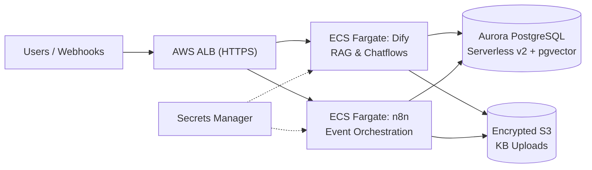

# Dify & n8n Production AWS Kit + Enterprise Blueprints

[](https://github.com/mabdullah-ml/dify-n8n-production-aws-kit/actions/workflows/ci.yml)
[](./LICENSE)
[-ff9900?style=flat-square)](#)
[](#)

> 🌐 **[日本語ドキュメントはこちら (README.ja.md)](./README.ja.md)**

A Forward-Deployed Engineer (FDE) production deployment kit for **self-hosted Dify & n8n on AWS** (VPC, ECS Fargate, Aurora PostgreSQL Serverless v2, Encrypted S3, Secrets Manager via **Terraform**), bundled with **reusable, CI-validated Dify DSL & n8n JSON workflow blueprints** for enterprise RAG support, AI-commerce, and nightly knowledge-base synchronization.

---

## Architecture



---

## Included Blueprints (`blueprints/`)

- `blueprints/dify/rag_enterprise_support.yml` — Knowledge-Base RAG Chatflow with confidence threshold routing and HITL webhook escalation.
- `blueprints/dify/ai_commerce_product_advisor.yml` — AI-Commerce intent classifier + live catalog lookup + personalized bundle generator.
- `blueprints/n8n/rag_ticket_triage.json` — Webhook → Dify RAG API → High-severity Slack escalation flow.
- `blueprints/n8n/daily_kb_sync_pipeline.json` — Nightly `02:00 JST` S3 → Dify Knowledge Base upsert pipeline.

## Quick Start

```bash
# Validate all Dify DSL & n8n JSON blueprints (schema + zero hardcoded secrets)
python scripts/validate_blueprints.py blueprints
pytest -v

# Start local PostgreSQL + Redis + n8n stack
cp .env.example .env
docker compose up -d
```

## Author

**Abdullah Mamun, Ph.D.** — Senior Generative AI / LLM Engineer · Forward-Deployed AI Engineer · PMP  
[GitHub](https://github.com/mabdullah-ml) · [LinkedIn](https://www.linkedin.com/in/mamunabdullah01)
